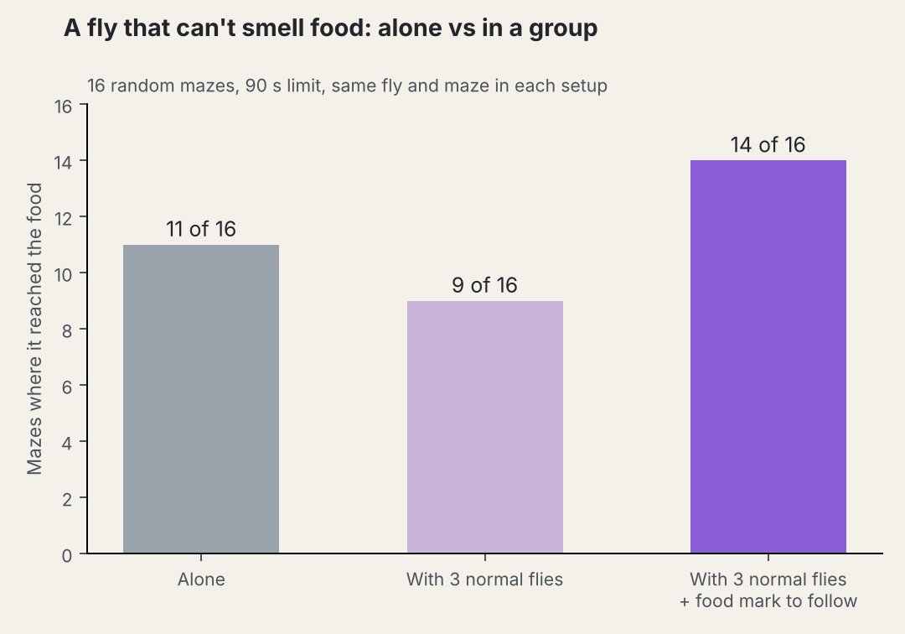
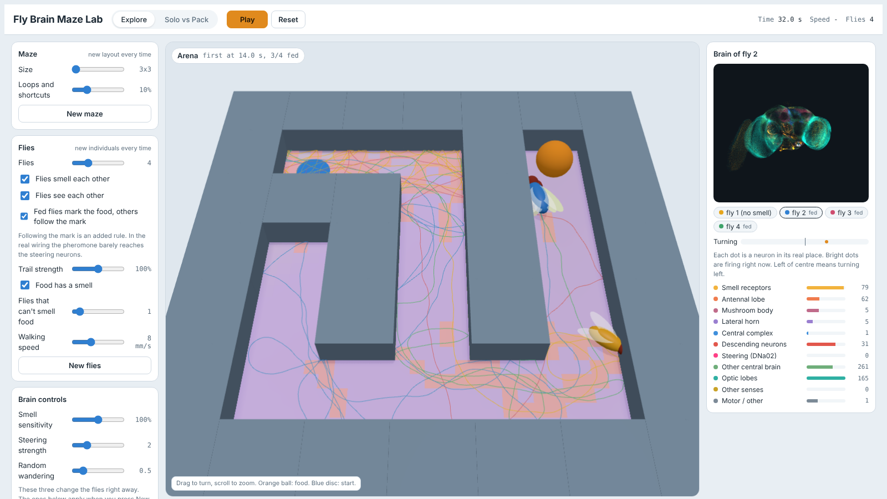

# Fly Brain Maze

Real fruit fly brains, wired from the FlyWire connectome, steering flies through a 3D maze toward food.

Each simulated fly runs a full spiking model of the adult fly brain (138,639 neurons, 15 million connections). The fly smells the food at its left and right antenna. That smell drives its real olfactory receptor neurons, and the activity spreads through the brain's actual wiring. Steering is read from 40 descending neurons, including DNa01, DNa02 and DNa04, which turn walking flies. Nothing about the maze is programmed into the brain.

## Run it

You need Python 3.10 or newer and git. Everything is free.

```bash
pip install -r requirements.txt
python3 get_data.py      # downloads the FlyWire data, about 230 MB, once
python3 server.py        # then open http://localhost:8000
```

## Using the app

- **Experiment** picks a preset: one fly that can smell, one with no smell (the control), a pack that smells each other's trails, a pack that ignores each other, or a fly with a brain region silenced.
- **Setup** changes the number of flies, maze size and layout, time limit and how strongly the left/right smell difference is passed on.
- **Silence brain regions** cuts every synapse to and from a region, like turning those neurons off.
- **Brain panel** (top right) shows the selected fly's brain. Every dot is one neuron at its real position, and it lights up when the neuron fires. The bars show the two steering neurons.
- **All brains** shows every fly's average firing in each region. Click a row to look at that fly's brain.
- **Replay** plays any saved run at full speed. Runs are saved in `runs/`.

Simulating every neuron takes work: one fly runs at roughly real time on a laptop, and a pack of 8 is about 20 times slower than real time. For packs, start a run, let it finish, and then replay it.

## What is real and what is a modelling choice

Real:
- The wiring: FlyWire v783 connectome (Dorkenwald et al. 2024, Schlegel et al. 2024), every neuron and synapse.
- The neuron model and its settings: the leaky integrate-and-fire model from Shiu et al. 2024 (Nature), checked here by reproducing their result that sugar taste neurons drive the MN9 feeding motor neuron.
- The inputs: vinegar-tuned olfactory receptor neurons (DM1, DM4, VA2, VM7d, DM2, DP1m).

Choices I made to close the loop, so the fly has a body:
- **Synapse fatigue in the smell center.** Without it, the antennal lobe's excitatory local neurons drive each other into runaway firing. Short-term depression (U = 0.5, 500 ms recovery) on receptor and local neuron synapses stops this. That kind of depression is documented in the fly antennal lobe.
- **Amplified left/right smell difference.** The odor changes by a few percent across a 2 mm head, so that difference is amplified before it reaches the receptors.
- **Steering readout.** With the brain held in place (no body), smell was played from the left, the right and both sides while every one of the 1,303 descending neurons was recorded (`calibrate.py`). The 40 neurons that best tell left from right were weighted into one steering signal, with even smell and no smell both reading as straight ahead (`make_readout.py`). It was fit on two recordings and checked on a third. The top neurons are the ones known to steer walking flies (DNa02, DNa01, DNa04), but the weights are a fit, not part of the connectome.
- **Body.** The fly walks at a fixed 8 mm/s with some random wandering, and turns away when it hits a wall. The brain only decides which way to turn.
- **Pack trails.** In pack mode each fly leaves a trail that others smell through their pheromone receptor neurons (DA1, VA1v, VA1d). How each brain reacts to it is up to the wiring.

## Results so far (one fly, 3x3 maze, 90 s limit)

| Fly | Found the food | Median time |
|---|---|---|
| No smell | 12 of 24 | over 86 s |
| Can smell, steering gain 3 | 17 of 24 | 65 s |
| Can smell, steering gain 6 (app default) | 10 of 12 | 48 s |

## 3D simulator in the browser (`live/`)

`live/` is a browser version of the same model that runs every fly's brain in Web Workers, with no install. Serve the folder and open it:

```bash
cd live && python3 -m http.server 8000   # then open http://localhost:8000
```

It works like a PhET simulation. Every press of New maze or New flies makes a new layout or new individuals (each neuron's firing threshold varies a little from fly to fly). You can change the maze size and loops, the number of flies, smell sensitivity, steering strength, wandering, synapse fatigue and individuality, and switch off brain regions. The **Solo vs Pack** tab races one fly against a pack. The right-hand panel shows the selected fly's neurons firing in their real positions, with activity per brain region.

Senses in the browser version:
- **Food smell** through the vinegar-tuned receptor neurons. Strength is felt on a log scale, so it keeps rising all the way to the food.
- **Other flies' smell** through the pheromone receptor neurons (DA1, VA1v, VA1d).
- **Sight of other flies** through the small-object visual neurons (LC10a, LC11, LC12, LC15, LC17, LC18, LC9, LC10d), with walls blocking the view and a blind spot behind.
- **Steering adaptation.** A turn signal that never changes fades over about 3 s, like sensory adaptation. This removes each fly's built-in left/right bias.
- **Food mark (optional, an added rule).** Flies that reach the food mark it, the mark spreads out along the corridors, and other flies turn toward it. Real fruit flies leave aggregation pheromones at food, but in the FlyWire wiring that pheromone barely reaches the steering neurons, so the turn toward the mark is added on top of the brain. It can be switched off.
- **Flies that can't smell food.** Any number of flies can have food smell removed while still sensing the others.

`live/race_node.mjs` runs the same simulation in node for batch experiments, and `live/capture.mjs` records the browser view frame by frame at real speed (open the page with `#capture`).

## Results: can a weaker fly gain from a group? (3x3 mazes, 90 s limit, 16 mazes each)

One fly had its food smell removed and ran the same 16 mazes three ways.

| Weaker fly | Reached the food |
|---|---|
| Alone | 11 of 16 |
| With 3 normal flies (smell and sight of each other) | 9 of 16 |
| With 3 normal flies and the food mark | 14 of 16 |

With only the copied wiring, being in a group doesn't help: pheromone input hardly reaches the steering neurons, and seeing another fly mostly makes a fly turn away. With the food mark added, the weaker fly usually reached the food within about 15 s of the first normal fly.

Solo flies with the browser settings (16 mazes, 60 s): 14 of 16 reached the food with smell and 6 of 16 without.




## Files

- `flybrain.py` is the whole-brain spiking model in numpy (used for the checks), and `fastbrain.py` is the same model compiled with numba, which the app uses.
- `arena.py` is the maze, the food smell and the trails.
- `engine.py` connects brains and bodies.
- `server.py` and `web/index.html` are the app (three.js is included in `web/vendor`, MIT license).
- `run_exp.py` and `batch.py` run experiments without the app; `record.py` saves a run for replay; `plot_paths.py` draws the paths.
- `calibrate.py` and `make_readout.py` build `steering_readout.npz` (`calibrate_vis.py` adds the visual recordings), and `export_web.py` writes the trimmed network the browser version loads.
- `live/` is the browser simulator (`brain.js` model, `world.js` maze, senses and bodies, `worker.js`, `index.html`).

## Credits

Code is MIT licensed. FlyWire connectome data (including the trimmed copy in `live/brain.b64.txt`) is CC BY 4.0. Please cite Dorkenwald et al. 2024 and Schlegel et al. 2024 (Nature) for the data and Shiu et al. 2024 (Nature) for the model.

Built with help from Claude.
